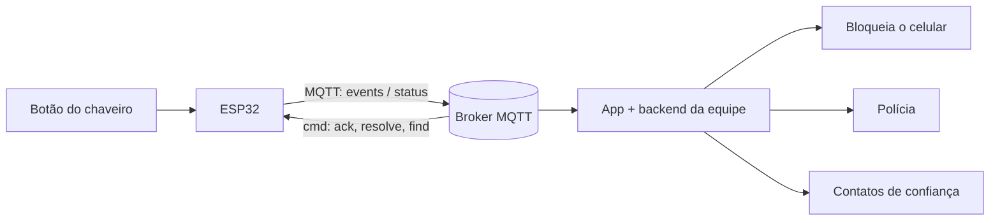

# Chaveiro de Pânico: parte IoT

Global Solution 2026.2 (FIAP, Engenharia de Software, 3º ano). Entrega de **Physical Computing: IOT & IOB**.

Um chaveiro com um botão. Um clique bloqueia o celular do usuário e envia um alerta silencioso para a polícia e para os contatos de confiança cadastrados no app. Este repositório tem só o chaveiro: circuito ESP32 no Wokwi, firmware e o contrato de comunicação com o app e o backend.

> **Link do Wokwi:** _(colar aqui depois de salvar o projeto)_
> **Vídeo (até 4 min):** _(colar aqui)_

## Ficha da CitizenTech

_A equipe preenche igual em todos os repositórios._

| | |
|---|---|
| Nome da CitizenTech | |
| Cidade e bairro | |
| Cidadão beneficiado | |
| Problema, em uma frase | |
| Como funciona | |
| O que cada parte faz | IoT: chaveiro com botão de pânico que avisa o app por MQTT (este repositório) |
| Link do repositório | |
| Indicador de impacto | |
| ODS conectados | 11 (cidades seguras), 3 (bem-estar), 10 (redução das desigualdades) |

## Por que um chaveiro

Num assalto, desbloquear o celular, abrir um app e apertar um botão chama atenção e muitas vezes é impossível, porque o celular é a primeira coisa levada. O chaveiro fica no bolso, junto das chaves, e funciona com um clique, sem olhar. O alerta é silencioso: nada de som ou luz forte que exponha a vítima.

Se o celular foi levado, o alerta continua saindo, porque o chaveiro fala direto com a nuvem e não depende do celular. O backend então bloqueia o celular à distância e usa a localização dele, o que ajuda a polícia a rastrear o aparelho.

## Como funciona



| Gesto | O que acontece |
|---|---|
| **1 clique** | dispara o alerta. Sai na hora e é reenviado a cada 5 s até o app confirmar. Soltar o botão antes de 3 s também conta como clique: na dúvida, o chaveiro pede ajuda. |
| **Segurar 3 s** com alerta ativo | cancela ("estou bem") |
| **Segurar 3 s** sem alerta | teste: confere se a cadeia chaveiro → app funciona, sem acionar ninguém |

O chaveiro não perde alerta. Se não houver rede, o evento espera e sai quando a conexão voltar. Se a bateria acabar ou o chaveiro reiniciar no meio do alerta, ele lembra (fica salvo na flash) e continua tentando. No Wokwi, cada vez que a simulação recomeça a flash começa vazia, então essa parte só aparece no hardware real.

O app pode mandar comandos de volta: confirmar o recebimento, encerrar o alerta e "achar meu chaveiro" (pisca e toca).

Os formatos das mensagens estão em [docs/contrato-mqtt.md](docs/contrato-mqtt.md). É o documento que o app e o backend precisam seguir.

O que o app precisa fazer (telas, fluxo do alerta, banco, critérios de aceite) está em [docs/especificacao-app.md](docs/especificacao-app.md). Dá para entregar esse arquivo direto para quem for construir o app.

## Circuito

| Componente | Pino ESP32 | Papel |
|---|---|---|
| Botão vermelho | GPIO 4 (pull-up interno) | botão de pânico |
| LED RGB (catodo comum) + 3 resistores 220 Ω | GPIO 27 (R), 26 (G), 25 (B) | retorno discreto para o usuário |
| Buzzer | GPIO 23 | só no "achar chaveiro" e no teste. Nunca toca no alerta. |
| Potenciômetro | GPIO 34 (ADC) | simula a tensão da bateria |

### O que o LED quer dizer

| LED | Estado |
|---|---|
| piscada verde curta a cada 4 s | conectado, tudo certo |
| piscada azul a cada 1 s | procurando rede |
| piscada vermelha curta a cada 1 s | alerta enviado, esperando o app confirmar |
| vermelho fixo por 3 s | app confirmou: ajuda a caminho |
| piscada vermelha a cada 5 s | alerta continua ativo |
| âmbar fixo | você está segurando o botão: continue até 3 s |
| verde piscando | alerta cancelado (na hora, no chaveiro) ou teste confirmado pelo app |
| piscada âmbar a cada 4 s | bateria baixa (≤ 15%) |
| azul e branco + bipes | "achar chaveiro" |

## Como rodar

### No navegador (wokwi.com)

1. Crie um projeto novo com **ESP32** em <https://wokwi.com/projects/new/esp32>.
2. Substitua `sketch.ino` e `diagram.json` pelos arquivos de [`sketch/`](sketch/).
3. Na aba **Library Manager**, adicione `PubSubClient` e `ArduinoJson` (ou crie o arquivo `libraries.txt` com o conteúdo de [`sketch/libraries.txt`](sketch/libraries.txt)).
4. Clique em ▶. O monitor serial mostra a conexão e cada evento.

O Wokwi conecta na rede `Wokwi-GUEST` sozinho, sem configurar nada.

Não rode duas simulações com o mesmo `DEVICE_ID` ao mesmo tempo (por exemplo, você e um colega): as duas usam o mesmo cliente no broker e ficam derrubando uma à outra. Se mais alguém for testar junto, troque o `DEVICE_ID` em `sketch.ino` na cópia dele.

### No VS Code (extensão Wokwi) ou terminal

```bash
cd sketch
arduino-cli compile --fqbn esp32:esp32:esp32 --output-dir build .
# depois: "Wokwi: Start Simulator" no VS Code, ou wokwi-cli .
```

### Simulando o app

Enquanto o app da equipe não está pronto, este script faz o papel dele: recebe o alerta, confirma e mostra o que seria feito.

```bash
pip install -r tools/requirements.txt
python tools/simulador_app.py
```

No terminal do simulador, `find`, `resolve` e `ping` mandam comandos ao chaveiro. Com `--no-ack`, ele não confirma nada, para mostrar o chaveiro reenviando.

## Roteiro do vídeo (até 4 min)

1. **O problema (30 s):** num assalto, a vítima não consegue usar o celular para pedir ajuda.
2. **A solução (30 s):** chaveiro com um botão, ligado ao app da equipe.
3. **O circuito (45 s):** mostrar botão, LED, buzzer e potenciômetro no Wokwi.
4. **Demonstração (1 min 45 s):**
   - clique → monitor serial mostra o alerta, LED pisca vermelho, simulador "bloqueia o celular e avisa polícia e contatos" e confirma → LED vermelho fixo;
   - segurar 3 s → cancela;
   - `--no-ack` → o chaveiro insiste até ser ouvido;
   - potenciômetro para baixo → aviso de bateria baixa no app;
   - `find` → chaveiro pisca e toca.
5. **Fechamento (30 s):** quem ajuda e como entra no resto da solução.

## Do protótipo ao produto

| No Wokwi | No chaveiro real |
|---|---|
| Wi-Fi `Wokwi-GUEST` | módulo celular LTE-M/NB-IoT (ex.: SIM7080G), para funcionar na rua sem depender do celular |
| broker público, sem senha | broker próprio com TLS e credencial por chaveiro (ver [contrato](docs/contrato-mqtt.md#segurança-o-que-muda-fora-do-protótipo)) |
| potenciômetro | bateria LiPo pequena com divisor de tensão no ADC |
| buzzer | motor de vibração, para confirmar sem fazer barulho |
| ESP32 DevKit | ESP32-C3 ou nRF em placa própria, dentro de uma capa de chaveiro |

## Dados e privacidade

O chaveiro só envia um identificador (`chaveiro-0001`), o tipo do evento, a hora e a bateria. Nome, telefone, contatos e localização ficam no app e no backend. Os contatos usados no simulador são fictícios.

## Estrutura

```
sketch/
  sketch.ino        firmware do ESP32
  diagram.json      circuito do Wokwi
  libraries.txt     bibliotecas do Wokwi
  wokwi.toml        configuração para VS Code / wokwi-cli
docs/
  contrato-mqtt.md  mensagens trocadas com o app e o backend
  especificacao-app.md  o que o app deve fazer (para a equipe do mobile)
tools/
  simulador_app.py  faz o papel do app na demonstração
integrantes.txt     nomes da equipe (pedido na entrega)
prompts.md          registro do uso de IA
```
