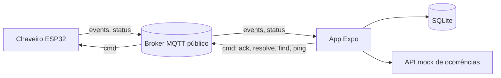

# Especificação do app: Chaveiro de Pânico

Documento para quem vai construir o app mobile (pessoa ou agente de IA). Ele é autossuficiente: tudo que o app precisa saber sobre o chaveiro está aqui. O contrato MQTT detalhado fica em [contrato-mqtt.md](contrato-mqtt.md).

## 1. O produto em uma frase

Um chaveiro com um botão: um clique dispara um alerta silencioso que bloqueia o celular do usuário e avisa a polícia e os contatos de confiança cadastrados no app.

## 2. Divisão de responsabilidades

| Parte | Quem faz | O que faz |
|---|---|---|
| Chaveiro (ESP32 no Wokwi) | **pronto** (repositório IoT) | detecta o clique, envia o evento por MQTT, reenvia até receber confirmação, mostra o estado no LED |
| App | **você** | pareia o chaveiro, cadastra contatos, recebe o alerta, confirma o recebimento, "bloqueia" o celular, avisa polícia e contatos, mostra histórico |

O chaveiro não sabe quem é o usuário nem quem são os contatos. Ele só manda "o chaveiro `chaveiro-0001` foi acionado". Quem transforma isso em ação é o app.

## 3. Requisitos da disciplina (Mobile Development & IoT)

A entrega é avaliada em 6 critérios: telas e navegação, consumo de dados, banco de dados, acessibilidade, aderência ao problema e documentação.

- Expo + React Native com **TypeScript** e **Expo Router**.
- Consumir dados de uma API ou de um mock. Aqui: as mensagens MQTT do chaveiro, mais uma API mock de ocorrências (seção 8).
- Salvar informações em banco de dados. Aqui: SQLite local com `expo-sqlite` (seção 9).
- Simples e acessível para quem não é especialista.
- README com a Ficha da CitizenTech, instruções para rodar, prints das telas e link do vídeo (até 3 min).
- **Nada de dados pessoais reais.** Contatos, telefones e nomes devem ser fictícios.

## 4. Arquitetura



No protótipo, o app se conecta direto ao broker MQTT por WebSocket. Não precisa de backend próprio para a demonstração. Se a equipe tiver um backend (disciplinas de C# ou SOA), ele pode assumir o papel de ouvir o MQTT mais tarde, mas **só um componente pode responder `ack`**. Para o GS, esse componente é o app.

### Conexão MQTT

| Item | Valor |
|---|---|
| URL (WebSocket com TLS) | `wss://broker.hivemq.com:8884/mqtt` |
| Tópicos que o app assina | `citizentech/chaveiro/<deviceId>/events` e `citizentech/chaveiro/<deviceId>/status` |
| Tópico onde o app publica | `citizentech/chaveiro/<deviceId>/cmd` |
| `deviceId` do chaveiro no Wokwi | `chaveiro-0001` |
| QoS | 1 |
| clientId | aleatório, ex.: `app-<8 caracteres>` |

Biblioteca: `mqtt` (mqtt.js) com URL `wss://` costuma funcionar no React Native, mas pode exigir polyfills (`buffer`, `url`, `process`). Se der trabalho, `paho-mqtt` (cliente JS por WebSocket) é a alternativa. **Teste a conexão no primeiro dia**, antes de construir as telas, e encapsule tudo num único módulo (`services/mqtt.ts`) para poder trocar a biblioteca sem mexer no resto.

Reconecte automaticamente e reassine os tópicos depois de reconectar. O broker público às vezes recusa a primeira conexão.

## 5. Mensagens

### Eventos que chegam em `.../events`

```json
{
  "eventId": "chaveiro-0001-6737a1f0-17",
  "type": "alert",
  "deviceId": "chaveiro-0001",
  "alertId": "chaveiro-0001-6737a1f0-17",
  "ts": 1763089200,
  "ageMs": 140,
  "attempt": 1,
  "battery": 82,
  "fw": "1.0.0"
}
```

| Campo | Uso no app |
|---|---|
| `eventId` | chave para descartar repetidos. Texto opaco: não tente interpretar o formato. |
| `type` | `alert`, `cancel`, `test` ou `low_battery` |
| `alertId` | em `alert`, igual ao `eventId`. Em `cancel`, o alerta que foi cancelado: procure o alerta por esse campo. |
| `ts` | hora do clique (segundos Unix, UTC). Pode vir `null`: nesse caso use `agora - ageMs` (aproximado se o chaveiro reiniciou no meio). |
| `battery` | % de bateria do chaveiro |

### Status que chega em `.../status` (mensagem retida)

```json
{ "deviceId": "chaveiro-0001", "online": true, "battery": 82, "lowBattery": false,
  "rssi": -61, "alertActive": false, "alertId": null, "uptimeS": 3600, "fw": "1.0.0" }
```

Chega ao assinar (é retida), a cada 30 s, logo depois de um alerta abrir ou fechar, e depois de um `ping`. Se o chaveiro cair, chega `{"deviceId":"chaveiro-0001","online":false}`, sem os outros campos.

### Comandos que o app publica em `.../cmd`

| Comando | Quando |
|---|---|
| `{"cmd":"ack","eventId":"..."}` | ao receber `alert`, `cancel` ou `test`. **Toda vez que o evento chegar**, inclusive repetido. |
| `{"cmd":"resolve","alertId":"..."}` | quando o usuário encerra o alerta pelo app |
| `{"cmd":"find"}` | botão "Achar meu chaveiro" (o chaveiro pisca e toca por 6 s). Desabilite o botão durante um alerta: o chaveiro ignora o comando para não fazer barulho. |
| `{"cmd":"ping"}` | ao abrir a tela inicial ou puxar para atualizar |

### Regra de ouro: idempotência

O chaveiro reenvia `alert`, `cancel` e `test` a cada 5 s até receber `ack`. O app **vai** receber o mesmo `eventId` várias vezes. A regra:

1. Se o `eventId` já está no banco: só responde `ack` e não faz mais nada.
2. Se é novo: grava no banco, responde `ack` e executa as ações.

Guarde os `eventId` no SQLite, não só em memória, para a regra valer depois de fechar o app.

Processe os eventos **na ordem de chegada**. O chaveiro garante que um `cancel` antigo chega antes de um `alert` mais novo, então "fechar todos os alertas ativos" num `cancel` nunca fecha uma emergência que ainda não chegou.

Um novo `alert` com `alertId` diferente enquanto outro alerta está aberto é uma **nova emergência** (o usuário clicou de novo depois do primeiro ser confirmado). Trate como um alerta novo.

## 6. O que fazer com cada evento

### `alert`: o fluxo principal

1. Gravar o alerta (status `ativo`) e responder `ack`. O LED do chaveiro fica vermelho fixo por 3 s: o usuário sabe que o app recebeu.
2. Abrir a tela **Alerta ativo** por cima de qualquer tela, com vibração (`expo-haptics`) e notificação local de alta prioridade (`expo-notifications`) se o app estiver em segundo plano.
3. **Bloquear o celular** (ver seção 7) e registrar o passo.
4. **Acionar a polícia**: `POST` na API mock de ocorrências (seção 8) e registrar o passo com o protocolo devolvido.
5. **Avisar cada contato**: um registro por contato (simulado, seção 8) com status `enviado`.
6. Mostrar na tela uma linha do tempo com cada passo e a hora: celular bloqueado, polícia acionada (protocolo), contatos avisados (3 de 3).

O alerta deve ser silencioso no celular também: vibração sim, som alto não. A pessoa pode estar sendo assaltada.

### `cancel`: o usuário segurou o botão 3 s ("estou bem")

1. Responder `ack`.
2. "Estou bem" vale para o usuário, não só para um alerta: feche **todos** os alertas ainda ativos desse `deviceId`, mesmo que o `alertId` do evento seja desconhecido (o alerta pode nem ter chegado). Se não houver nenhum alerta ativo, pare aqui.
3. Mudar esses alertas para `cancelado`, registrar a hora.
4. Avisar polícia e contatos do cancelamento (mesmo mecanismo simulado).
5. Fechar a tela de alerta e mostrar "Alerta cancelado pelo chaveiro".

### `test`: o usuário segurou o botão 3 s sem alerta ativo

1. Responder `ack`. O chaveiro pisca verde e bipa.
2. Mostrar "Chaveiro funcionando ✓" e gravar no histórico como `teste`.
3. **Não** acionar polícia nem contatos.

### `low_battery`

Notificação "Bateria do chaveiro em 12%. Carregue para continuar protegido." Não precisa de `ack`.

### Encerrar pelo app

Na tela de alerta, o botão "Estou bem, encerrar alerta" pede o PIN do app. Ao confirmar: publica `resolve`, muda o alerta para `resolvido` e avisa contatos e polícia do encerramento.

Extra opcional, que vale ponto em "aderência ao problema": **PIN de coação**. Se o usuário digitar esse segundo PIN (por exemplo, porque o assaltante mandou cancelar), o app finge que encerrou, mas mantém o alerta ativo e avisa os contatos que o cancelamento foi forçado.

## 7. Bloqueio do celular: o que é possível

Seja honesto sobre isso no README e no vídeo:

- **Android:** bloquear a tela de verdade exige `DevicePolicyManager.lockNow()`, com o app como administrador do dispositivo. Isso precisa de módulo nativo (development build). Não funciona no Expo Go.
- **iOS:** não existe API para um app bloquear o celular.

**No protótipo:** o app entra em **Modo bloqueado**, uma tela cheia que esconde todo o conteúdo do app e só sai com o PIN. Isso demonstra a ideia sem módulo nativo. Escreva no README como seria no produto: administrador do dispositivo no Android, e no iOS orientar o uso do "Buscar iPhone / Marcar como perdido".

## 8. Polícia e contatos: simulados

Não há API pública para acionar o 190 automaticamente, e enviar SMS sem o usuário tocar na tela exige um serviço pago no backend. No protótipo:

- **Polícia:** uma API mock. Pode ser o backend da equipe, um MockAPI/json-server ou um módulo `services/policia.ts` que simula a resposta com atraso. Contrato sugerido:

  ```
  POST /ocorrencias
  { "alertId": "chaveiro-0001-6737a1f0-17", "deviceId": "chaveiro-0001", "ts": 1763089200,
    "localizacao": { "lat": -23.5641, "lng": -46.6527 } }

  201 { "protocolo": "SP-2026-000123", "status": "recebida" }
  ```

- **Contatos:** `services/contatos.ts` com uma interface `notificar(contato, mensagem)` que, no protótipo, só registra o envio no banco e devolve sucesso. No produto, seria trocada por SMS/WhatsApp pelo backend.
- **Localização:** pode usar `expo-location` para pegar a posição na hora do alerta. Para a demonstração, uma coordenada fixa e fictícia também serve.

## 9. Banco de dados (SQLite)

```sql
CREATE TABLE dispositivo (
  device_id      TEXT PRIMARY KEY,      -- 'chaveiro-0001'
  apelido        TEXT NOT NULL,         -- 'Meu chaveiro'
  pareado_em     INTEGER NOT NULL,
  online         INTEGER NOT NULL DEFAULT 0,
  bateria        INTEGER,
  visto_por_ultimo INTEGER
);

CREATE TABLE contato (
  id         INTEGER PRIMARY KEY AUTOINCREMENT,
  nome       TEXT NOT NULL,
  telefone   TEXT NOT NULL,             -- fictício
  relacao    TEXT,                      -- 'mãe', 'amigo'...
  canal      TEXT NOT NULL CHECK (canal IN ('SMS','WhatsApp'))
);

CREATE TABLE alerta (
  alert_id     TEXT PRIMARY KEY,        -- igual ao eventId do alert
  device_id    TEXT NOT NULL,
  tipo         TEXT NOT NULL CHECK (tipo IN ('alerta','teste')),
  status       TEXT NOT NULL CHECK (status IN ('ativo','cancelado','resolvido','teste')),
  acionado_em  INTEGER NOT NULL,        -- hora do clique
  recebido_em  INTEGER NOT NULL,
  encerrado_em INTEGER,
  protocolo    TEXT                     -- devolvido pela API de ocorrências
);

CREATE TABLE passo_alerta (             -- linha do tempo de cada alerta
  id        INTEGER PRIMARY KEY AUTOINCREMENT,
  alert_id  TEXT NOT NULL REFERENCES alerta(alert_id),
  descricao TEXT NOT NULL,              -- 'Celular bloqueado', 'Contato avisado: Ana (SMS)'
  ok        INTEGER NOT NULL,
  em        INTEGER NOT NULL
);

CREATE TABLE evento_recebido (          -- idempotência
  event_id    TEXT PRIMARY KEY,
  recebido_em INTEGER NOT NULL
);
```

O PIN fica em `expo-secure-store`, não no SQLite.

## 10. Telas (Expo Router)

```
app/
  _layout.tsx              raiz: inicia MQTT e banco, escuta eventos, abre o alerta
  onboarding.tsx           primeira vez: explicação + parear + criar PIN
  (tabs)/_layout.tsx
  (tabs)/index.tsx         Início
  (tabs)/contatos.tsx      lista de contatos
  (tabs)/historico.tsx     histórico de alertas
  (tabs)/ajustes.tsx       ajustes
  contato/[id].tsx         criar/editar contato
  alerta/[id].tsx          detalhe de um alerta (linha do tempo)
  alerta-ativo.tsx         modal em tela cheia durante o alerta
  bloqueado.tsx            "Modo bloqueado", só sai com PIN
```

| Tela | Conteúdo |
|---|---|
| **Onboarding** | 3 passos curtos: o que o chaveiro faz; parear (ler QR code com `expo-camera` ou digitar `chaveiro-0001`); criar PIN de 4 dígitos. Ao parear, assina os tópicos e espera o primeiro `status` para confirmar que o chaveiro existe. |
| **Início** | cartão grande do chaveiro: online/offline, bateria, "visto há 2 min". Frase de estado ("Você está protegido" ou "Chaveiro desconectado"). Botões "Achar meu chaveiro" (`find`) e "Como testar" (explica: segure o botão 3 s). Último alerta, se houver. Aviso se não há contatos cadastrados. |
| **Contatos** | lista com nome, relação e canal. Adicionar, editar e excluir. No máximo 5. Validação de nome e telefone. Estado vazio que explica por que cadastrar. |
| **Histórico** | lista de alertas e testes, do mais novo ao mais antigo, com status colorido **e** escrito. Toque abre o detalhe. |
| **Detalhe do alerta** | linha do tempo dos passos com hora; protocolo da ocorrência. |
| **Alerta ativo** | tela vermelha, título grande "Alerta enviado". Linha do tempo atualizando ao vivo. Botão "Estou bem, encerrar alerta" (pede PIN). |
| **Modo bloqueado** | tela neutra sem nenhum dado do usuário, teclado de PIN. |
| **Ajustes** | dados do chaveiro (id, firmware, bateria), desparear, trocar PIN, PIN de coação (opcional), **modo demonstração**. |

### Modo demonstração

Um botão escondido em Ajustes que gera eventos falsos (`alert`, `cancel`, `test`, `low_battery`) e os injeta no mesmo fluxo que as mensagens MQTT usam. Assim o vídeo funciona mesmo se o broker público cair no dia. Implemente o fluxo de eventos como uma função `handleEvent(evento)` que tanto o MQTT quanto o modo demonstração chamam.

## 11. Acessibilidade

- Textos com no mínimo 16 pt, títulos maiores. Respeitar o tamanho de fonte do sistema (não travar `allowFontScaling`).
- Contraste mínimo 4.5:1. Estado nunca indicado só pela cor: sempre há texto ("Ativo", "Cancelado").
- Alvos de toque de pelo menos 48×48 dp. O botão de encerrar alerta é grande.
- `accessibilityLabel` e `accessibilityRole` em todos os botões e ícones.
- Quando o alerta chega, anunciar para leitores de tela com `AccessibilityInfo.announceForAccessibility("Alerta enviado. Ajuda a caminho.")`.
- Linguagem simples: "Estou bem", não "Resolver incidente".

## 12. Como testar sem o chaveiro físico

1. **Wokwi:** abra o projeto do chaveiro (link no README do repositório IoT) e clique ▶. Clique no botão vermelho para alertar e segure por 3 s para cancelar ou testar. O monitor serial mostra cada envio e cada `ack`.
2. **Cliente web da HiveMQ:** <https://www.hivemq.com/demos/websocket-client/>. Conecte, publique um evento em `citizentech/chaveiro/chaveiro-0001/events` (exemplo abaixo) e veja o `ack` em `.../cmd`.
3. **Modo demonstração** do próprio app.

Evento de teste para colar no cliente web:

```json
{"eventId":"chaveiro-0001-teste-1","type":"alert","deviceId":"chaveiro-0001","alertId":"chaveiro-0001-teste-1","ts":null,"ageMs":0,"attempt":1,"battery":80,"fw":"1.0.0"}
```

Publique duas vezes o mesmo evento: o app deve responder `ack` nas duas e executar as ações só na primeira.

O broker é público. Para não receber eventos de outras equipes, use sempre o `deviceId` pareado nos tópicos, nunca curingas como `citizentech/#`.

## 13. Critérios de aceite

- [ ] Parear com `chaveiro-0001` e ver online/offline e bateria atualizando sozinhos.
- [ ] Cadastrar, editar e excluir contatos. Os dados continuam lá depois de fechar o app.
- [ ] Clique no chaveiro (Wokwi) → em até 3 s o app abre a tela de alerta, mostra os passos e o LED do chaveiro fica vermelho fixo por 3 s (recebeu o `ack`).
- [ ] O mesmo `eventId` recebido 5 vezes gera 1 alerta no histórico e 5 `ack`.
- [ ] Segurar 3 s no chaveiro durante o alerta → app mostra "cancelado" e fecha a tela de alerta.
- [ ] Segurar 3 s sem alerta → app mostra "Chaveiro funcionando" e não aciona ninguém.
- [ ] Encerrar pelo app com PIN → chaveiro sai do modo alerta (recebeu `resolve`).
- [ ] "Achar meu chaveiro" → chaveiro pisca e toca.
- [ ] Bateria no potenciômetro abaixo de 15% → notificação no app.
- [ ] Desligar a simulação do chaveiro → app mostra "desconectado" em até ~90 s.
- [ ] Modo demonstração dispara o fluxo completo sem internet.
- [ ] Leitor de tela consegue navegar todas as telas e anuncia o alerta.
- [ ] Nenhum dado pessoal real no app, no banco ou nos prints.

## 14. Fora do escopo do protótipo

Login e contas na nuvem, envio real de SMS/WhatsApp, integração real com a polícia, bloqueio real do sistema operacional, broker com autenticação. Cite no README como próximos passos.
